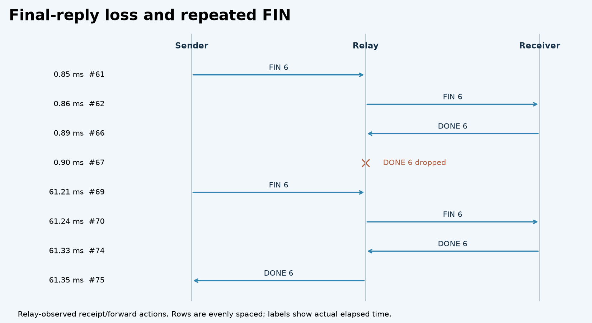

# Loopback UDP reliability lab

A bounded stop-and-wait byte-transfer protocol using real UDP sockets, with a local relay that drops, duplicates, delays and corrupts predeclared datagrams. The sender, relay and receiver bind only to `127.0.0.1` on ephemeral ports.



This AI-assisted portfolio exercise uses seeded synthetic payloads and locally scheduled faults. All timing records come from actual socket runs. The traces are application instrumentation, not PCAP captures or NIC timestamps.

## Review the evidence

- [Static report](docs/report.html), [measured findings](results/findings.md) and [summary CSV](results/summary.csv).
- [Per-run JSON summaries and JSONL traces](results/raw/), including captured received payload bytes in hexadecimal and SHA-256 comparisons.
- [Protocol state machines and wire codec](udp_lab/protocol.py) and [actual socket harness](udp_lab/transport.py).
- [Protocol specification](docs/protocol.md), [fault model and limits](docs/failure-model.md), [measurement and reproduction](docs/reproduction.md).
- [Screenshots](docs/screenshots/README.md) and [continuous report review](docs/recordings/README.md).

## What is implemented

- Strict versioned binary frames with 16-byte session, sequence/total bounds, declared length and CRC32 over header plus payload.
- At most 128 chunks of 512 bytes: 64 KiB per transfer and a 548-byte maximum datagram.
- One outstanding frame, matching ACK validation, bounded retries, duplicate-content checks and in-order reassembly.
- FIN/DONE completion handshake with SHA-256 verification and replies to repeated FIN after a lost DONE.
- Injected-clock protocol tests, independent combined-fault schedules and repeated actual-socket integration tests.

CRC and digest checks detect accidental corruption; they do not authenticate peers. Fixture session IDs are deterministic and are not secure anti-replay tokens. Receiver completion and sender confirmation remain separate states: if every DONE is lost, the receiver can finish while the sender reports failure.

## Run it

Python 3.13 is the tested runtime. The protocol and tests use the standard library; plotting has pinned dependencies.

```sh
python -m unittest discover -s tests -v
python -m pip install -r requirements.txt
python scripts/run_study.py --output-dir build/my-run
python scripts/verify_results.py --output-dir build/my-run
```

Open `build/my-run/docs/report.html`. The default study runs 48 transfers: eight schedules, budgets of one/four attempts and three repetitions. `--quick` uses one repetition (16 transfers). Each transfer has a 1.5-second harness deadline; ordinary scenarios take a fraction of a second. Two helper threads and three sockets are closed after each run, including errors.

The driver runs the complete test suite before fresh measurements. It preserves original evidence when an output directory is supplied. Running without that option replaces committed results. `--reuse` regenerates charts from existing data and refuses changed protocol/transport source hashes. CI verifies committed evidence, then runs a fresh quick study under Ubuntu.

## Interpreting comparisons

The comparison is the same protocol with one versus four attempts per frame. It is not a comparison against an optimized best-effort UDP implementation. Fault keys match direction, kind, sequence and occurrence, so both budgets encounter the same declared rule if they reach its target. An early failure can prevent later targets from being reached.

Terminal time includes successes and retry-budget failures. It is not WAN latency or a throughput estimate. The report keeps receiver completion, sender confirmation and byte equality visible separately. There is no persistence, congestion control, adaptive retransmission timer, sliding window, restart recovery or exactly-once external execution guarantee.
